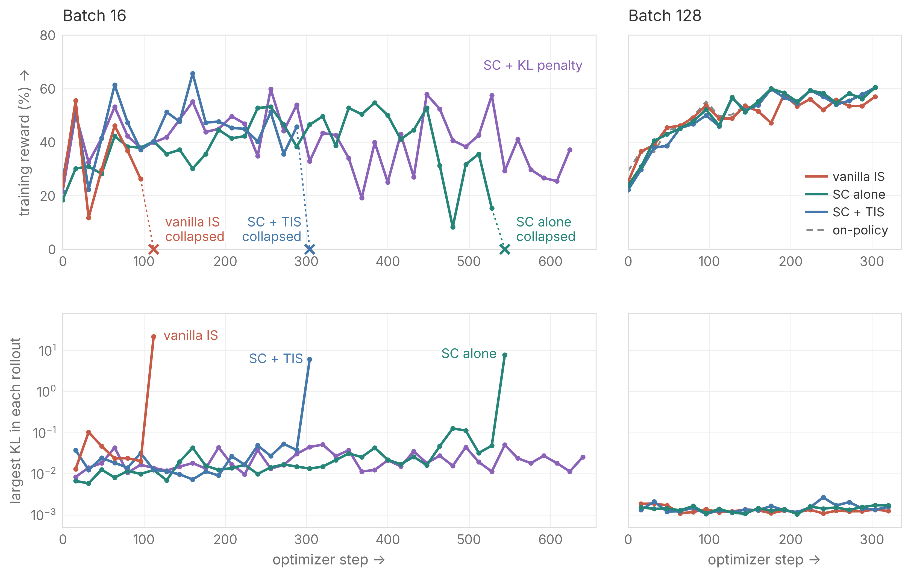

<div align="center">

# Drift and Distance:<br>When Is Score Centering Enough in Async RL?

[](https://rl-cookbook.github.io/sc-drift-and-distance/)
[](LICENSE)

</div>

In async RL for LLMs, the trainer learns from data that an older policy sampled, creating a gap called staleness.
Score centering (SC) removes drift, the most harmful error this gap causes. We ask when SC alone is enough, and
whether importance sampling (IS) or a KL penalty helps when it is not.

We find that what matters after SC is distance, how far the trainer moves from the sampler before fresh data arrives.
A larger batch shrinks the noisy part of this distance, and less staleness or a lower learning rate shrinks the rest.
Truncated IS does not prevent collapse, and a KL penalty at best matches a lower learning rate. This repository has the
code and run scripts behind the blog's figures.


*Figure 8 of the blog. Qwen3.5-4B-Base on DAPO-Math-17k at staleness 15. At batch 16, vanilla IS, SC alone, and SC +
truncated importance sampling (TIS) collapse after a sudden spike in the KL to the sampler. At batch 128, all three keep
up with on-policy training.*

## Quick Start

SkyRL is included in `SkyRL/`, with score centering and our changes (see [`SkyRL/MODIFICATIONS.md`](SkyRL/MODIFICATIONS.md)).
The scripts need [uv](https://docs.astral.sh/uv/), and each run uses one node with 8 GPUs of 80 GB.

```bash
bash scripts/prepare_data.sh      # GSM8K, DAPO-Math-17k and AIME into ~/data/drift
wandb login
NAME=st15-b64-sc-s1 N=16 B=64 CAP=0 SC=true bash scripts/run.sh
```

`N` is the number of mini-batches per rollout, so the staleness is `N - 1`, and `B` is the batch size. This run is SC
alone at staleness 15 and batch 64. The methods differ in a few variables.

| Method | Settings |
|--|--|
| SC alone | `CAP=0 SC=true` |
| SC + TIS | `CAP=2 SC=true` |
| Vanilla IS | `CAP=1e9 SC=false` |
| SC + min(1, w) | `CAP=0 SC=true BRAKE=true` |
| SC + KL penalty | `CAP=0 SC=true KL_BETA=0.075` |
| SC + decaying KL penalty | `CAP=0 SC=true KL_BETA=0.3 KL_SCHEDULE=inv_sqrt_age` |
| On-policy | `N=1 CAP=0 SC=true` |

<details>
<summary><b>All options of <code>scripts/run.sh</code></b></summary>

| Variable | Default | Usage |
|--|--|--|
| `NAME` | required | Weights & Biases (W&B) run name and checkpoint directory |
| `MODEL` | `0.8B` | `0.8B` (Qwen3.5-0.8B-Base on GSM8K) or `4B` (Qwen3.5-4B-Base on DAPO-Math-17k) |
| `N` | `16` | mini-batches per rollout (maximum staleness `N - 1`), `N=1` is on-policy |
| `B` | `64` | responses per optimizer step (8 per prompt) |
| `LR` | `0.03`, `0.033` for 4B | SGD learning rate |
| `CAP` | `0` | importance weight, `0` none, `2` TIS, `1e9` vanilla IS |
| `SC` | `true` | score centering over the sampler's top-32 tokens |
| `BRAKE` | `false` | SC + min(1, w), which scales the terms with negative advantage by `min(1, p/q)` |
| `KL_BETA` | `0` | constant KL penalty toward the sampler |
| `KL_SCHEDULE` | `constant` | `inv_sqrt_age` decays the penalty to `KL_BETA / sqrt(k)` on mini-batch `k`, with none on `k = 0` |
| `KL_EXACT` | `false` | exact KL over the sampler's top-32 tokens instead of its k1 estimate (needs `SC=true`) |
| `FP8`, `FP8_KV` | `false` | fp8 sampler (weights and activations), and an fp8 KV cache |
| `OPT_STEPS`, `SEED` | `640`, `1` | optimizer steps and seed |
| `EVAL` | `true`, `false` for 4B | evaluate during training (500 GSM8K problems every 64 steps) |
| `EPOCHS` | `10` | dataloader epochs, enough to cover `OPT_STEPS` |
| `DATA_DIR`, `CKPT_DIR` | `~/data/drift`, `~/ckpts/drift` | data and checkpoint directories |

</details>

## Reproducing the Blog

Each script in `experiments/` has one run per line, named after its setting and method (`st15-b64-sc-s1` is staleness
15, batch 64, SC alone, seed 1). Later scripts reuse runs from earlier ones, so run them in order.

| Figure | Experiment | Script |
|--|--|--|
| 4 | SC and IS, each on and off | `sec2_1_sc_is_grid.sh` |
| 5, 6 | Batch 64 against batch 512 | `sec2_2_large_batch.sh` |
| 7 | SC alone at staleness 63 | `sec2_3_small_batch.sh` |
| 8, 9 | 4B on DAPO-Math-17k, with evaluation | `sec2_3_4b.sh` |
| 10 | KL at batch 128 over batch 1024 | `sec3_kl_ratio.sh` |
| 11 | Larger batch, lower learning rate, less staleness | `sec4_1_settings.sh` |
| 12 to 15 | Importance weights: not always safer | `sec4_2_importance_weights.sh` |
| 16 | KL penalty against a lower learning rate | `sec4_3_kl_penalty.sh` |

The tests check the loss on the CPU with `cd SkyRL && uv run --isolated --extra fsdp --with pytest python -m pytest ../tests -q`.

## Citation

```bibtex
@misc{liu2026driftdistance,
  author       = {Liu, Shu and Fang, Qi and Agarwal, Shubham},
  title        = {Drift and Distance: When Is Score Centering Enough in Async RL?},
  howpublished = {Blog post},
  year         = {2026},
  url          = {https://rl-cookbook.github.io/sc-drift-and-distance/}
}
```

## Acknowledgement

This work is built on [SkyRL](https://github.com/NovaSky-AI/SkyRL) and Eric Tang's score centering implementation in it
([PR #2244](https://github.com/NovaSky-AI/SkyRL/pull/2244)). We thank Souradip Chakraborty, Daanish Khazi, Qiuyang Mang, Yi Pan,
Charlie Ruan, Eric Tang, Yichuan Wang, Minghao Yan, and Chenxiao Yang for helpful discussions and feedback.
